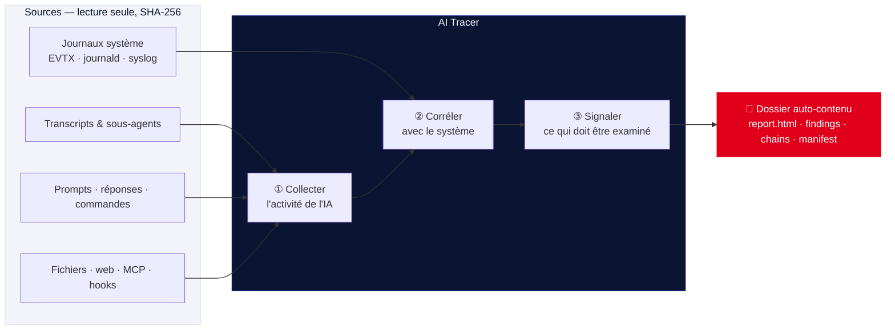

<div align="center">


# AI Tracer — Forensic des agents IA

**Ce que l'IA a fait sur ce poste, reconstitué et prouvé.**

AI Tracer reconstitue l'activité d'un agent IA à partir des traces locales, la recoupe
avec les journaux du système et produit un **rapport d'expertise vérifiable**, avec sa
chaîne de possession.

<br>

[](https://aitrace.fr)
[](https://aitrace.fr)
[](.github/workflows/static.yml)
[](mentions-legales.html)


<br>

[Fonctionnement](#-fonctionnement) ·
[Détections](#-détections) ·
[Rapport](#-le-rapport) ·
[Garanties](#-garanties) ·
[Démarrage](#-démarrage-rapide) ·
[Documentation](documentation.html)

</div>

---

> **Ce dépôt** héberge le site vitrine de l'outil AI Tracer (`aitrace.fr`), publié
> automatiquement sur GitHub Pages. L'outil `aitrace` lui-même est réservé aux
> professionnels et distribué sous licence.

---

## 🔎 Fonctionnement

> **Trois questions, une seule analyse.**
> Qu'a fait l'IA ? Qu'a fait le système pendant ce temps ? Quelque chose de suspect
> s'est-il produit ? AI Tracer répond aux trois en un passage.



| Étape | Ce qu'elle fait |
|------|------------------|
| **① Collecter** | Transcripts et sous-agents, prompts, réponses, commandes, fichiers modifiés, accès web et MCP, configuration, hooks et extensions. *Les identifiants ne sont jamais lus.* |
| **② Corréler** | Chaque processus est rattaché à la commande IA qui l'a lancé. Ce qui s'est passé pendant l'activité de l'IA **sans venir d'elle** ressort en priorité. |
| **③ Signaler** | Injections de prompt, commandes dangereuses, caractères masqués, indicateurs de compromission : classés par gravité, chacun renvoyé à sa source. |

### Un récit, pas une liste d'alertes

AI Tracer relie une injection reçue par un canal non fiable aux actions de la même
session qui ont suivi :

```
T          Injection reçue      Dans le résultat d'une page web lue par l'agent
T + 6 s    Lecture d'une clé SSH  Fichier sensible ouvert par l'agent
T + 13 s   Envoi réseau          Accès sortant dans la même session
```

---

## 🚨 Détections

> **Orienter l'examen, sans décider à la place de l'expert.**
> Chaque signalement porte sa **gravité**, ses techniques **MITRE ATT&CK**, sa catégorie
> **OWASP LLM** et le **fichier et la ligne** d'où il vient.

- **Injection de prompt** — dans les sorties d'outils, fichiers lus, pages web, résultats MCP et contenus collés.
- **Caractères Unicode masqués** — balises Unicode, largeur nulle, contrôles bidirectionnels. Le message caché est décodé.
- **Commandes suspectes** — téléchargement puis exécution, reverse shell, vol d'identifiants, effacement de journaux, persistance. Les commandes encodées sont déobfusquées.
- **Indicateurs de compromission** — hôtes, IP et empreintes recoupés avec votre propre liste d'IOC.
- **Intégrité des journaux** — effacements, journaux commencés trop tard, journalisation des processus absente.
- **Mode permissif** — une commande suspecte lancée sans contrôle des permissions voit sa gravité relevée.

---

## 📄 Le rapport

> **Un dossier auto-contenu, prêt à verser.**
> Un rapport HTML autonome, sans ressource externe. Des fichiers structurés pour vos
> outils. Des empreintes pour tout vérifier.

```
E:\cas42\run-01\
├── report.html            Synthèse, détections, chronologie filtrable, chaîne de possession
├── findings.json
├── findings.sarif.json    Signalements au format SARIF 2.1.0
├── chains.json            Scénarios injection → actions
├── events.json / .csv     Chronologie complète, protégée contre l'injection de formules
├── correlation.json
├── case.json
├── manifest.json          Contexte d'exécution et empreinte de chaque source
├── evidence/
└── SHA256SUMS.txt         Empreintes de tous les fichiers du rapport
```

Chaque événement de la chronologie renvoie à son **origine exacte**, fichier et ligne,
pour revenir à la source.

---

## 🛡️ Garanties

| Garantie | Détail |
|----------|--------|
| **Chaîne de possession** | Affaire, examinateurs, scellés, machine, compte, ligne de commande, version de l'outil et empreinte agrégée des sources, consignés à chaque analyse. |
| **Écriture confinée** | Seul le dossier de sortie est écrit. L'outil refuse un dossier non vide ou situé dans une zone de preuve. |
| **Gestion des affaires** | Un registre suit chaque affaire, sur plusieurs machines, et permet de reprendre l'analyse là où elle s'était arrêtée. |
| **Limites affichées** | La détection est heuristique et le dit. Les angles morts, comme une journalisation absente, sont signalés dans le rapport. |

**Un exécutable, rien à installer** · **Lecture seule** · **SHA-256 revérifié** ·
**Windows, Linux, macOS** (poste en fonctionnement ou image montée).

---

## ▶️ Démarrage rapide

```bash
aitrace.exe --case CAS-42 --all-users --since 7d \
  --tz local --collect-raw --out E:\cas42\run-01
```

> Sources ouvertes en lecture seule, hachées en SHA-256.
> Rapport écrit dans `E:\cas42\run-01`.

Quelques options courantes (voir la [documentation complète](documentation.html)) :

| Option | Rôle |
|--------|------|
| `--case` / `--case-id` | Identifiant de l'affaire |
| `--examiner` | Examinateur(s) consigné(s) dans la chaîne de possession |
| `--all-users` | Analyser tous les comptes du poste |
| `--since` / `--until` / `--window` | Fenêtre temporelle de l'analyse |
| `--ioc` | Liste d'indicateurs de compromission à recouper |
| `--collect-raw` | Conserver les sources brutes dans `evidence/` |
| `--seal` | Sceller l'affaire |
| `--resume` | Reprendre une analyse interrompue |
| `--out` | Dossier de sortie (doit être vide, hors zone de preuve) |

---

## 👥 Pour qui

- **Experts judiciaires** — un rapport structuré et traçable à joindre à l'expertise.
- **Services d'enquête** — une analyse sur poste saisi ou image disque, hors ligne.
- **Réponse à incident** — comprendre vite ce qu'un agent IA compromis a touché.

Version actuelle : **Claude Code** (CLI, IDE) et **Claude Desktop**.

---

## 🧱 Ce dépôt (le site)

```
.
├── index.html             Page d'accueil
├── documentation.html     Documentation de l'outil
├── confidentialite.html   Politique de confidentialité
├── mentions-legales.html  Mentions légales
├── 404.html
├── css/                   base.css · documentation.css
├── media/                 logo.png · trailer.mp4 · tutoriel
├── CNAME                  aitrace.fr
├── robots.txt · sitemap.xml
└── .github/workflows/static.yml   Déploiement GitHub Pages
```

**Développement local** — le site est statique, aucun build requis :

```bash
python -m http.server 8000     # puis http://localhost:8000
```

Tout push sur `master` est publié automatiquement sur GitHub Pages
([`static.yml`](.github/workflows/static.yml)).

---

## 📬 Contact & licence

AI Tracer est réservé aux professionnels et distribué sous licence. Nous présentons
l'outil et un rapport type sur un jeu de données de démonstration — demande via
[aitrace.fr](https://aitrace.fr) ou **joam.brochard@aitrace.fr**.

<div align="center">

© 2026 **Joam Brochard** — Tous droits réservés
· [Mentions légales](mentions-legales.html)
· [Confidentialité](confidentialite.html)

</div>
